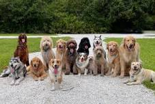

# 📦 Smart Inventory Counter

A computer vision application that uses YOLO object detection to automatically detect, classify, and count objects from images. Built with Python, OpenCV, and Streamlit.

## Features

- **AI Object Detection** — Detect objects using a pretrained YOLO model.
- **Automated Inventory Counting** — Count detected objects by category.
- **Image Visualization** — Display bounding boxes and detection labels.
- **Adjustable Confidence Threshold** — Control detection sensitivity.
- **Inventory Analytics** — View category-wise inventory statistics.
- **CSV Export** — Download inventory results for further analysis.
- **Interactive Dashboard** — Simple web interface built with Streamlit.

## Tech Stack

- Python
- Ultralytics YOLO
- OpenCV
- Streamlit
- Pandas
- NumPy

## Project Structure

```text
smart-inventory-counter/
├── app.py
├── detector.py
├── inventory.py
├── requirements.txt
├── README.md
└── .gitignore
```
### Bottles Example

| Input | Output |
| :--- | :--- |
|  |  |

### Dogs Example

| Input | Output |
| :--- | :--- |
|  |  |

## Installation

### 1. Clone the repository

```bash
git clone https://github.com/YOUR-USERNAME/smart-inventory-counter.git
cd smart-inventory-counter
```

### 2. Create a virtual environment

```bash
python -m venv venv
```

Activate it on Windows:

```bash
venv\Scripts\activate
```

### 3. Install dependencies

```bash
pip install -r requirements.txt
```

### 4. Run the application

```bash
streamlit run app.py
```

The application will open in your browser.

## How It Works

1. Upload an image containing objects.
2. YOLO processes the image and identifies objects.
3. Bounding boxes are generated for detected objects.
4. The detections are grouped by object category.
5. An inventory summary is generated.
6. Results can be visualized and exported as a CSV file.

## Limitations

- Uses a pretrained general-purpose object detection model.
- Detection performance varies depending on object size, visibility, lighting, and overlap.
- Does not identify specific product brands or SKUs.
- Objects that are hidden or heavily occluded may not be detected.
- Counts are based on visible detections and may not represent actual stock.

## Future Improvements

- Custom-trained models for specific retail products.
- Video-based inventory monitoring.
- Object tracking to avoid duplicate counts across frames.
- Low-stock alerts and threshold configuration.
- Inventory history and analytics dashboard.

*Built as a computer vision project exploring object detection and automated inventory analysis.*
